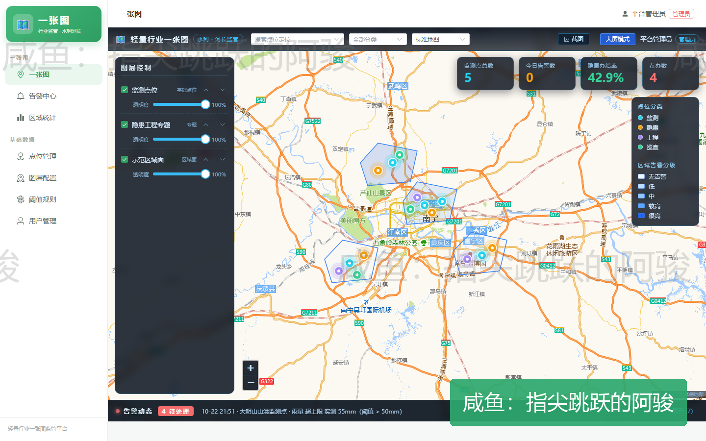
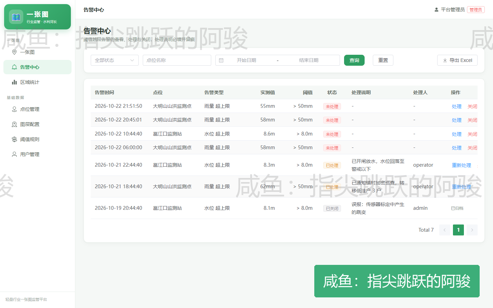
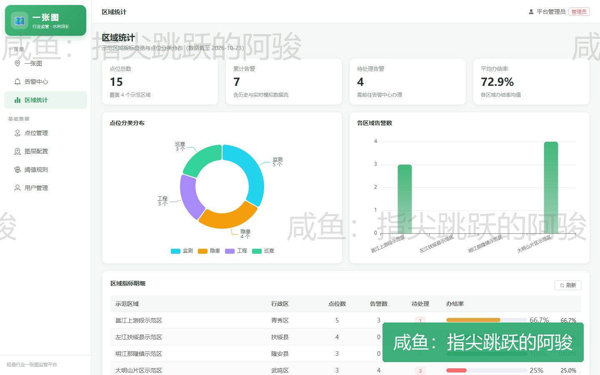
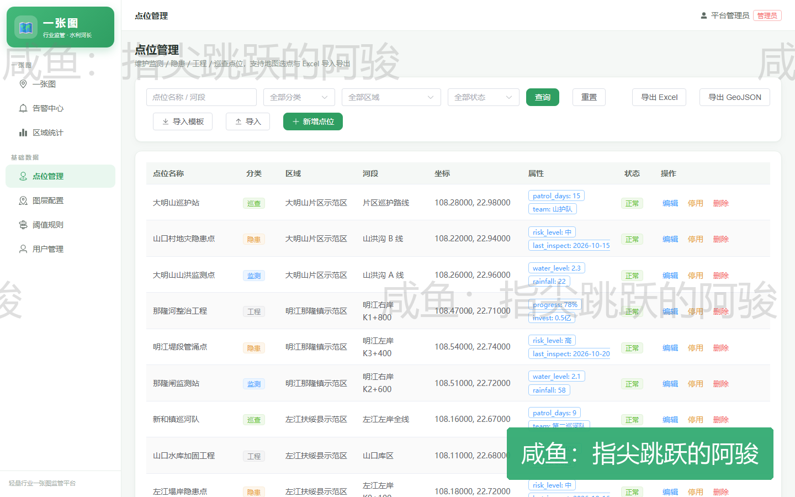
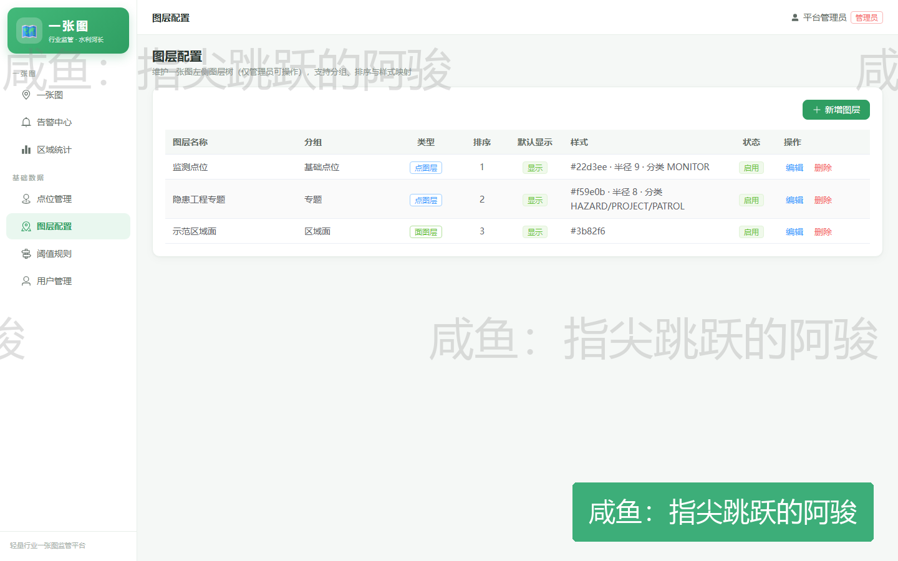
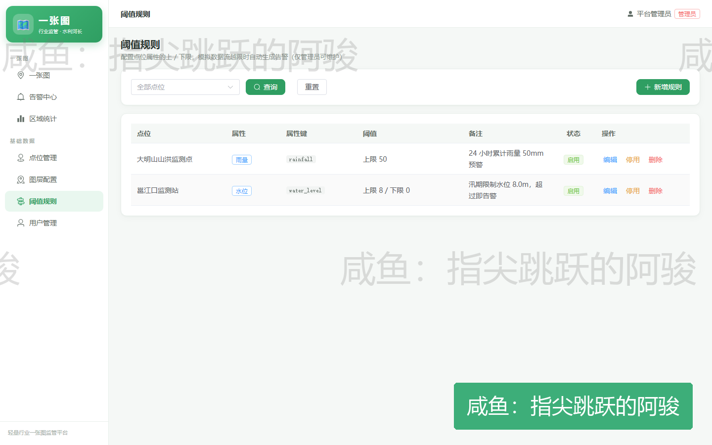

# 轻量行业一张图监管平台

> 一套可复用的轻量级「行业一张图」监管平台底座：地图一张图 + 告警中心 + 点位管理 + 阈值规则 + 区域统计，适合快速套到农业、水利、环保等行业的监测监管场景。

## 界面预览

**PC 管理后台**

| 一张图 | 告警中心 | 区域统计 |
|---|---|---|
|  |  |  |

| 点位管理 | 图层配置 | 阈值规则 |
|---|---|---|
|  |  |  |

## 解决什么问题

政务/行业监管项目里「一张图」需求高度重复：**底图 + 点位 + 告警 + 统计**。本平台把它抽成可配置的通用底座：

- 点位可配置：点位类型、图标、所属区域全部后台维护，新增监测点不改代码
- 告警可配置：按指标设阈值规则，超限自动产生告警，告警中心统一处置
- 统计可配置：按区域汇总点位数量、告警数、指标趋势，图表联动

## 技术架构

```
admin（Vue 3 + Element Plus + ECharts）   管理后台（一张图 / 告警 / 统计）
        │
        ▼
server（Spring Boot 3 + MyBatis-Plus + JWT）
        │
        ▼
   MySQL（sql/yizhangtu.sql 一键建库）
```

| 模块 | 技术栈 | 说明 |
|---|---|---|
| `admin` | Vue 3、Element Plus、Pinia、ECharts | 单页管理后台：一张图 / 告警中心 / 点位管理 / 图层配置 / 阈值规则 / 区域统计 / 用户管理 |
| `server` | Spring Boot、MyBatis-Plus、JWT、MySQL | 单体后端，`YZT_*` 环境变量覆盖配置，本地与云上一套代码 |
| `deploy` | Docker Compose、Nginx | 云端一键部署：MySQL + 后端 + 前端静态托管 |
| `sql` | MySQL | 建库脚本 + 演示数据 |

## 快速开始

```bash
# 1. 数据库
mysql -uroot -p < sql/yizhangtu.sql

# 2. 后端（默认连 localhost:3306/yizhangtu，账号 root/123456，可用 YZT_* 环境变量覆盖）
cd server && mvn spring-boot:run

# 3. 管理后台
cd admin && npm install && npm run dev
```

## 说明

- 仓库内点位、告警、区域数据均为**演示数据**，不含任何真实业务数据
- 项目由本人独立完成（需求、设计、前后端开发、部署）
